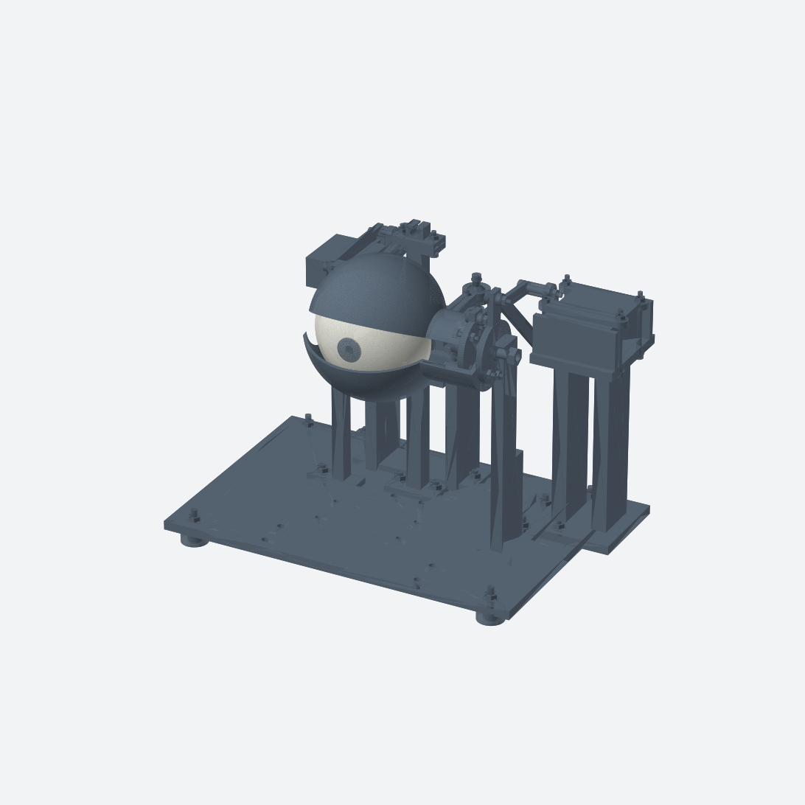
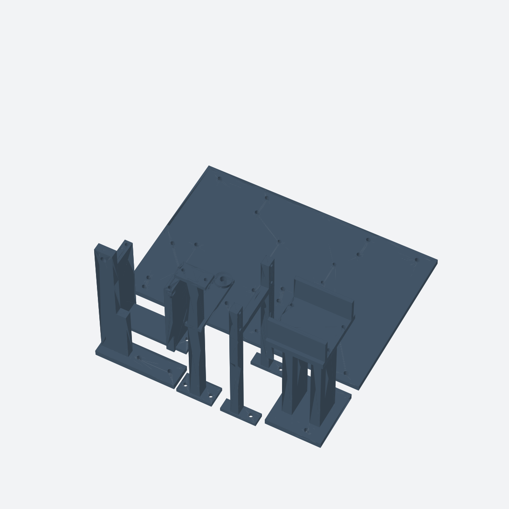
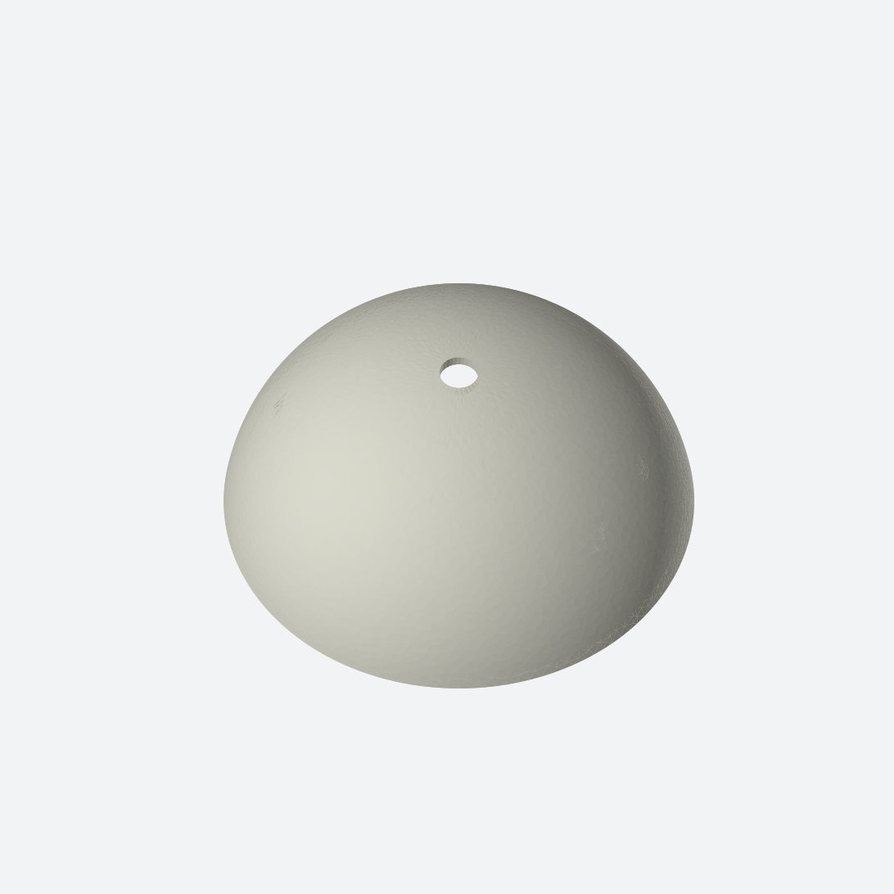

# RoboEye — Mechanical Eye

Animatronisches Auge von Leon Rohrer mit zwei Blickachsen und gekoppelten Lidern: vollständige CAD-Baugruppe, drei Druckplatten und parametrische KCL-Quellen.

## Fertige CAD-Baugruppe

[Assembly als STL herunterladen](exports/assembly/main.stl?raw=true) · [Originaler OBJ-Export](exports/assembly/RoboEye.obj) · [CAD-Einstieg: main.kcl](cad/main.kcl)

Die Baugruppe enthält auch Servoreferenzen, Originalhörner und Schrauben. Sie dient zur Gesamtansicht und ist keine Druckplatte. Die vollständige Assembly-STL ist etwa 15 MB groß; die Ansicht oben ist direkt auf GitHub sichtbar, die STL lässt sich lokal im 3D-Viewer öffnen.

## Alle drei Print Plates

| Platte 1 · Schwarz | Platte 2 · Schwarz | Platte 3 · Weiß |
|---|---|---|
|  |  |  |
| 6 Teile: Grundplatte und fünf Halter | 49 Teile: Lider, Mechanik, Pupille und Kleinteile | 1 Teil: offene Augenschale mit Blindloch-Befestigungen |
| [STL](exports/print-plates/printPlate01Black.stl) · [KCL](cad/printPlate01Black.kcl) | [STL](exports/print-plates/printPlate02Black.stl) · [KCL](cad/printPlate02Black.kcl) | [STL](exports/print-plates/printPlate03White.stl) · [KCL](cad/printPlate03White.kcl) |

Die Bilder führen zu den jeweiligen STL-Dateien. Insgesamt **56 Druckteile** für nominell 256 × 256 mm große Druckplatten. STL in **Millimetern** importieren; Kontrollmaß der Grundplatte: **244 × 164 × 6 mm**. Druckfarbe im Slicer wählen, da STL keine Farben speichert.

Platte 1 und 2 stammen aus vorhandenen STL-Exporten. Platte 3 wurde aus der eindeutig identifizierten weißen Schale des vorhandenen Assembly-OBJ gewonnen und entsprechend ihrer KCL-Datei ausgerichtet; die Dreiecksgeometrie wurde beibehalten. Details und Dateiprüfungen: [PUBLICATION_CHECKS.md](PUBLICATION_CHECKS.md).

## CAD und Montage

Den gesamten Ordner [cad](cad) lokal öffnen; [project.toml](cad/project.toml) verwendet `main.kcl` als Einstieg. Alle lokal importierten KCL-Module sind enthalten. Für eine einzelne Druckplatte deren KCL-Datei öffnen.

- [Druckplan und Slicer-Hinweise](docs/DRUCKPLAN.md)
- [Aktuelle Druckstückliste: 56 Teile](docs/DRUCKTEILE.csv)
- [Montageanleitung](docs/MONTAGE.md) und [aktueller CAD-Stand](docs/NOTES.md)
- [Montage der schwarzen Druckteile](docs/MONTAGE_PLATTE_01_02.md)
- [Bewegungsstudie](docs/BEWEGUNGSSTUDIE.md), [Prüfbericht](docs/PRUEFBERICHT.md) und [Checkliste](docs/CHECKLIST.md)

Entwicklungsprototyp: CAD-Ansichten und strukturelle Mesh-Prüfungen ersetzen keine Slicer-, Passungs-, Festigkeits- oder realen Funktionstests. Support und Brim müssen im Slicer geprüft werden. Es sind keine 3MF-Slicerprojekte und kein G-Code enthalten.

## Historischer Bestand und Urheberschaft

Die ursprünglich veröffentlichte Datei [Auge1.stl](Auge1.stl) bleibt als historischer Einzelteil-Export erhalten. Auch ältere CAD-Studien und `docs/BOM.csv` bleiben dokumentiert; für den aktuellen Drucksatz gelten die drei oben verlinkten Platten und `docs/DRUCKTEILE.csv`.

Leon Rohrer bestätigte am 29.10.2026, dass dies sein eigener Entwurf ist, und gab die öffentliche Veröffentlichung frei. Bestehende Urheber- und Lizenzhinweise bleiben gültig; diese Veröffentlichung führt keine neue Lizenz ein. Lokale Cloud-Projekt- und Konversations-IDs wurden nicht übernommen.
