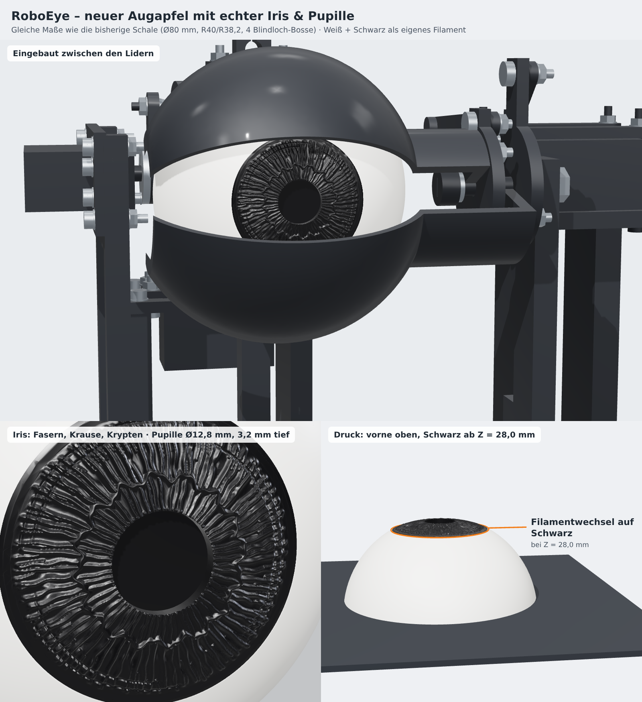

# Realistischer Augapfel – Weiß + Schwarz

Neuer Augapfel für das RoboEye mit **denselben Maßen und derselben Befestigung** wie die bisherige weiße Schale `cad/eyeFront.kcl` (Platte 3). Iris und Pupille sind direkt im Augapfel enthalten und werden in **schwarzem Filament** gedruckt. Die separate Pupille (`cad/pupil.kcl`, Platte 2) und ihre M2-Schraube werden damit nicht mehr benötigt.

## Dateien

| Datei | Inhalt | Verwendung |
|---|---|---|
| [realisticEye_weiss.stl](../exports/realistic-eye/realisticEye_weiss.stl) | Lederhaut (Sklera) mit den 4 Blindloch-Bossen, bis Z = 28,0 mm | Mehrfarbdruck, Teil 1 |
| [realisticEye_schwarz.stl](../exports/realistic-eye/realisticEye_schwarz.stl) | Iris + Pupille, ab Z = 28,0 mm | Mehrfarbdruck, Teil 2 |
| [realisticEye_komplett.stl](../exports/realistic-eye/realisticEye_komplett.stl) | Beides als ein Körper | Einzel-Extruder mit Filamentwechsel |
| [build_info.json](../exports/realistic-eye/build_info.json) | Kennmaße, Volumen, Dreieckszahlen | Prüfung |
| [generate_realistic_eye.py](../tools/generate_realistic_eye.py) | Parametrische Quelle (Python, `numpy` + `manifold3d`) | Neu erzeugen: `python3 tools/generate_realistic_eye.py` |

Alle STL in **Millimetern**, gleiche Lage wie `printPlate03White.stl`: Mitte X/Y = 128 mm, hinterer Rand auf Z = 0, Vorderseite nach oben. Nicht skalieren.

## Maße

- Außen R40 (Ø80), innen R38,2, offene Rückseite 7 mm vor Kugelmitte – unverändert.
- 4 Bosse R2,8 mit Pilotloch Ø1,7 × 5 mm bei X ±28 / Y ±8 – unverändert, gleiche Schrauben 2 × 8 mm von hinten.
- Sichtbares Schwarz Ø38,7 mm (Iris im Verhältnis wie beim echten Auge, ca. 49 % des Augapfels).
- Iris liegt wie hinter einer Hornhaut leicht vertieft (1,5 mm in der Mitte, weich auslaufend zum Rand).
- Relief: radiale Fasern (Trabekel), Zickzack-Krause (Collarette), gekerbter Pupillensaum, Krypten und Kontraktionsfurchen; Höhe ca. 0,2–0,5 mm.
- Pupille Ø12,8 mm, 3,2 mm tief – wirkt dadurch dunkler als die Iris.
- Nichts ragt über die R40-Kugel hinaus (größter Radius 40,0 mm) → Lidabstand unverändert.
- Innen ist die Iris mit Schwarz hinterfüttert (flache Unterseite 35 mm vor Kugelmitte). Abstand zum Augenträger (vorderste Stelle 33 mm vor Kugelmitte): 2 mm.

## Drucken

### Variante A – Mehrfarbdrucker (AMS, MMU, Toolchanger)
1. `realisticEye_weiss.stl` und `realisticEye_schwarz.stl` **gleichzeitig** importieren.
2. Frage „als ein Objekt mit mehreren Teilen laden?“ mit **Ja** beantworten (PrusaSlicer, Bambu Studio, OrcaSlicer).
3. Teil „schwarz“ dem schwarzen Filament zuweisen. Teile nicht gegeneinander verschieben.

### Variante B – ein Extruder, Filamentwechsel am Ende
1. `realisticEye_komplett.stl` laden und weiß drucken.
2. Im Schichtvorschau-Regler einen **Farbwechsel/M600 bei Z = 28,0 mm** einfügen: auf die erste Schicht oberhalb von 28,0 mm (bei 0,2 mm Schichthöhe die Schicht „28,2“).
3. Ab dort schwarz weiterdrucken. Alle Vertiefungen der Iris enden mindestens 0,28 mm über der Wechselhöhe; ein Versatz um eine Schicht zeigt daher kein Weiß, nur der Irisrand wandert um ca. 0,2 mm.

### Einstellungen für beide Varianten
- Ab ca. Z = 27 mm **0,08–0,12 mm Schichthöhe** (Höhenbereich-Modifier oder variable Schichthöhe), damit das feine Iris-Relief erhalten bleibt. Darunter normal (z. B. 0,2 mm).
- 0,4-mm-Düse, Wandgenerator Arachne, kein Bügeln (Ironing) auf der Iris.
- **Stützen nur von der Bauplatte** (innen, durch die offene Rückseite) – wie bei der bisherigen Schale nötig für das Kuppeldach. Neu ist eine flache schwarze Unterseite Ø30,6 mm auf Z = 28 mm innen in der Kuppel; sie liegt im Stützbereich. Außen keine Stützen.
- Möglichst deckendes Schwarz verwenden: Am äußersten Irisrand liegt Schwarz nur dünn (0,2–0,3 mm) auf Weiß, das gibt einen leicht weichen Limbusring.
- Tipp für mehr Lebendigkeit: Die Iris nach dem Druck dünn mit Klarlack (glänzend) überziehen – das wirkt wie die feuchte Hornhaut.

## Montage
Wie bisher: Augapfel von hinten mit 4 gewindeformenden Kunststoffschrauben 2 × 8 mm am Augenträger befestigen. Die alte Pupille von Platte 2 und ihre M2-Schraube entfallen. Die Pupille ist geschlossen; eine spätere Kamera hinter der Pupille bräuchte eine eigene Öffnung.

## Prüfung (4.11.2026)
- Alle drei STL wasserdicht, je ein Körper, konsistente Orientierung; Volumen Weiß 12 880,8 + Schwarz 1 924,9 = Komplett 14 805,7 mm³.
- Vergleich mit `exports/print-plates/printPlate03White.stl` unterhalb Z = 28 mm: gleiche Außenmaße (X/Y 88,617–167,383 mm), Volumen 12 879,3 → 12 880,8 mm³, Abweichungsvolumen 124,6 mm³ (entspricht im Mittel ca. 0,01 mm Flächenabstand, Tessellierung). Pilotlöcher und Bosse: Punkt-Innen/Außen-Test identisch zum Original.
- Im Generator geprüft: keine Iris-/Pupillenfläche näher als 0,25 mm an der Wechselhöhe, größter Radius ≤ 40,0 mm.
- Bilder mit three.js aus den exportierten STL gerendert.

Nicht geprüft: Slicer-Vorschau, echter Druck, Detailtreue des Reliefs mit realer Düse/Material, Passung am Augenträger. Diese Datei ersetzt keinen Probedruck.
